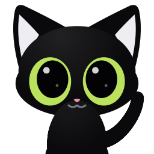
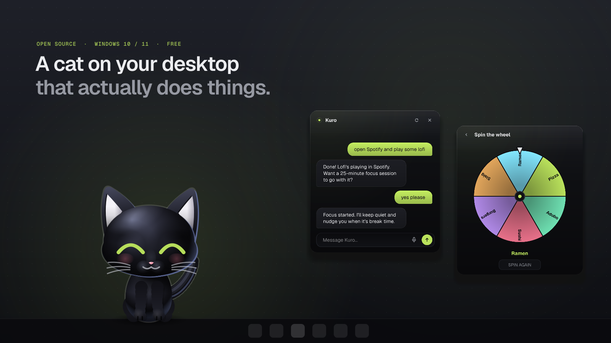
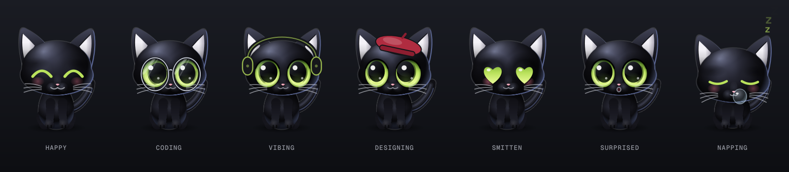

  

<h1 align="center">Kuro</h1>

  <b>A little black cat who lives on your Windows desktop, talks with you, and actually does things on your PC.</b>

  

  
  
  
  
  

  

Kuro is a JARVIS-style AI companion in the shape of a desktop pet. Ask him to open an app, set a reminder, quiz you on your notes or tell you why your PC is slow, and he does it, for real, then tells you in his own voice. He's **free and open source**: you pick his brain from Gemini, Groq or OpenRouter (free keys), Ollama (free, fully offline), or OpenAI / Claude (paid).

Found a bug or have an idea? [Open an issue](https://github.com/Addurei/kuro/issues).

## Quick start

1. Download **[KuroSetup.exe](https://github.com/Addurei/kuro/releases/latest/download/KuroSetup.exe)** and run it. No admin rights needed, and if Python isn't on your PC the installer sets it up for you. (Windows may say "Windows protected your PC" because the installer isn't signed yet: **More info → Run anyway**.)
2. Kuro starts when the installer finishes (the very first start takes a few minutes while he sets up his libraries). On first launch Kuro introduces himself, asks your name and sets up his brain with you (Groq: free, fast, generous limits) in about a minute.
3. Other brains any time: right-click Kuro → ⚙ Settings → **AI & Voice**.

Prefer running from source? Install Python 3.12 (tick "Add python.exe to PATH"), clone this repo and double-click `run.bat`.

| Brain | Cost | Notes |
|---|---|---|
| Gemini | free key | Best all-rounder; can see your screen and images |
| Groq | free key | Very fast replies |
| OpenRouter | free key | Kuro only uses its free models |
| Ollama | free, offline | Runs on your PC (run `setup_offline_brain.bat` once; ~16 GB RAM recommended) |
| OpenAI / Claude | paid key | Strongest; both can see images |

Kuro picks the best model each key can use; type one in Settings → Model to override it.

**Backup brain:** add keys for more than one brain (e.g. Groq *and* Gemini). When one runs out of free uses or can't be reached, Kuro switches to the next by himself, notes it in the chat, and lets the tired one rest for 15 minutes. (Settings → AI & Voice → Backup brain.)
If Test fails, it shows the provider's exact reason (bad key, no internet, limit reached…). Errors are also logged to `%APPDATA%\Kuro\kuro.log`.

## Using him

| Do this | To |
|---|---|
| Double-click Kuro / `Ctrl+Alt+K` | Open or close the chat |
| `Ctrl+Alt+Space` | Talk (push-to-talk) |
| Say "Hey Kuro…" | Hands-free (turn on in Settings → Voice) |
| Select text anywhere + `Ctrl+Alt+Q` | Quick actions: summarize · explain · rewrite · fix · translate |
| Click | Pet him (shows the timer while you focus) |
| Right-click | Radial menu: chat · talk · focus · memory · settings · quit |
| Drag / throw | Pick him up; he stays where he lands |
| Esc | Close the HUD |

## What he can do

  

- **Chat in character**: replies stream in word by word, and he starts speaking as soon as the first sentence is done. Chat size and his own size: Settings → General.
- **Talks naturally**: a neural voice (Piper: Amy, Ryan or Lessac) running offline on your PC, optional "cute" pitch; the Windows voice takes over if the natural one isn't available. First use downloads the voice once (~60 MB).
- **Listens well**: Whisper on Groq with your same free key (English, Filipino and Taglish), then OpenAI Whisper, then Google as a last resort.
- **Speaks your language**: English, Filipino or Taglish (Settings → AI & Voice → Language): his replies, his own lines, and how he listens.
- **Your shortcuts**: click one in Settings → AI & Voice → Shortcuts and press new keys. Clashes and Windows' own shortcuts are refused.
- **Control your PC**: apps, sites, files, folders, windows, volume, media, screenshots, clipboard, lock. Power actions and PowerShell always ask first.
  Apps are found by name (Start menu, Store apps, installed programs), and he waits for the window to actually appear before saying it's open. If it doesn't, he tells you.
- **Scan** (just ask): a document, PDF, Word file, code, an image, copied or pasted text, the song playing, your screen, or your PC.
- **Study mode**: "make a quiz from biology.pdf" or "flashcards from these notes". Opens in the Study panel. Every question is checked (4 distinct options, one valid answer) before it's shown.
- **Focus companion**: right-click → FOCUS (or "focus for 50 minutes"). Pomodoro cycles; he naps on the taskbar with a timer ring, wakes you for breaks, cheers at the end, and keeps daily stats.
- **Daily briefing**: once a day, the first time he sees you: weather (he finds your city from your connection, nothing to type), today's calendar, reminders, unread mail, yesterday's focus. Or ask "brief me".
- **Google Calendar + Gmail** (optional): see and add events (adding asks first), read your inbox. Gmail is read-only: he can never send, delete or change mail.
- **Knows what you're doing** (from the app and window title only, never what's inside): glasses when you code or study, a pencil behind his ear when you write, a beret in Blender / design apps. His paws tap along when you type (he counts key presses, never which keys). Now and then a short line about it ("Working on Kuro again?"), at most one every 15 minutes, never during focus or fullscreen. Turn it off: Settings → General → React to what I'm doing.
- **Reminders** that survive restarts.
- **Sums and conversions done exactly**: "15% of 240", "5 ft in cm". He uses a calculator, never guesses.
- **To-do list**: "add buy cat food to my list", "what's on my list?", "tick off the thesis one".
- **Saves what he writes**: "write that as notes.txt on my desktop". Never overwrites a file, and can't create programs or scripts.
- **Routines**: "when I say study mode, open VS Code, play lofi and focus for 25 minutes". Then just say "study mode".
- **Why is my PC slow?**: which apps are eating memory and CPU, and "close Chrome" (he asks first).
- **Tidy a folder**: "tidy my downloads" sorts loose files into Images, Documents, Videos... Shows the plan and asks first, deletes nothing, and "undo that" puts everything back.
- **Dark mode and brightness**: "dark mode on", "brightness 40" (brightness on laptop screens).
- **Battery warning**: tells you once at 20% and once at 10% when you're unplugged.
- **The Show panel**: "spin a wheel to pick dinner" opens a real wheel that spins and lands; "flip a coin", "roll a d20" and "chart my study hours: mon 3, tue 7..." become an animated coin, die, or bar/line/pie chart. The result is decided fairly and Kuro says it too.
- **He updates himself.** Once a day he checks this repo for a new version, downloads it quietly, and applies it the next time he starts. Settings and keys are never touched, and a bad download can't break the running Kuro.
- **Learns about you** (Right-click → Memory to review or forget).
- **Teleports** around your screens now and then (5 styles), and **hides during fullscreen** games and videos, holding any messages until you're back.

### Connecting Google (one-time, ~5 minutes)

1. Go to console.cloud.google.com → create a project.
2. APIs & Services → Library: enable **Google Calendar API** and **Gmail API**.
3. OAuth consent screen: External, add your app name, and add yourself as a **test user**.
4. Credentials → Create credentials → OAuth client ID → **Desktop app**. Copy the client ID and secret.
5. Kuro → Settings → Google: paste both, press CONNECT, sign in in the browser.

The sign-in token is stored encrypted for your Windows account (DPAPI) in `%APPDATA%\Kuro\google.token`.

## The HUD

There's only one panel, and it's pinned above Kuro's head. It follows him wherever he goes and reshapes itself between the speech bubble, chat, settings, memory and the "allow this?" prompt. A lime light runs around its border: faster while he's thinking, red when he needs your permission.

## Known limits

- Free brains have rate limits. When he hits one, he says so and tries the next model.
- Web answers (news, scores) use Google Search with Gemini, and a DuckDuckGo search with the other brains.
- Voice needs internet: push-to-talk uses Whisper (with your Groq key, Google as a fallback), and "Hey Kuro" uses Google's free speech service. The wake word only sends short phrases that sound like speech.
- Windows only for now.
- Connecting Gmail uses your own Google Cloud project (steps above), because Google only lets verified apps read mail for the public.

## Privacy

Kuro runs on your PC. Your API keys, settings and what he learns about you stay in `%APPDATA%\Kuro` on your machine; delete that folder and he forgets everything. What leaves your PC:

- your messages, to the brain you picked (Gemini, Groq, OpenRouter, OpenAI or Claude), or nothing at all with Ollama
- a rough location from your IP address, and weather for it (geojs / ipapi / ipwho.is, Open-Meteo)
- web searches you ask for (DuckDuckGo), and Gmail only if you connect your Google account
- downloads of his voices (Hugging Face) and update checks (this GitHub repo)

## Under the hood

Kuro is written in Python with PySide6 (Qt). Everything below is for the curious and for contributors.

### How he moves

Kuro is drawn fresh every frame (60 fps) from a skeleton, not a flipbook:

- **Body**: a flexible spine from hips to chest that stretches and gathers when he gallops, with tapered tubes for flesh.
- **Legs**: shoulder → elbow → paw and hip → knee → paw, solved with two-bone IK, so paws plant and joints bend naturally. Walk and gallop are real gait patterns, and his paws advance with distance travelled, so they never slide.
- **2.5D**: the skeleton is projected for his current angle, so he turns smoothly from facing you to side-on.
- **Springs everywhere**: every pose value glides with a little overshoot. Speed changes kick the head (it lags), ears (they flop) and tail (it drags).

| File | Role |
|---|---|
| `app/ui/cat_rig.py` | The skeleton, IK, gaits and drawing |
| `app/ui/cat.py` | Behaviour, teleports, physics, sparks |
| `app/ui/quick.py` | Quick-actions panel |
| `app/features.py` | Focus, study, briefing, Google, quick actions, wake word, do-not-disturb |
| `app/focus.py` · `app/study.py` · `app/briefing.py` · `app/google.py` | The logic behind them |
| `app/ui/hud.py` | The pinned HUD (all pages) and the radial menu |
| `app/ui/theme.py` | Matte look, running border light, icons |
| `app/providers.py` | All six brains: format translation, automatic model choice, fallbacks, error reasons |
| `app/launcher.py` | Finding, opening and confirming apps |
| `app/activity.py` | What you're doing (coding, writing, 3D…), typing pace, his comments |
| `scripts/slim.py` | Removes unused libraries after installs (tests Qt before deleting) |
| `app/location.py` | Automatic city + weather (Open-Meteo, free, no key) |
| `app/brain.py` | Tool-use loop, persona, history |
| `app/tools.py` | Every PC action. **Add new abilities here** |
| `app/memory.py` | Facts, habits, background reflection |
| `app/controller.py` | Wires it all together |

## Custom characters 🎨

The whole engine is character-driven: every colour, name, pronoun and accessory
comes from one dict (`app/character.py`). To reskin your install, drop a
`CHARACTER.json` next to `main.py` — anything you set (fur palette, eye colours,
accent, a neck ribbon, eyeliner, wake words, personality) deep-merges over
Kuro's defaults, and the `folder` key gives your character its own settings in
`%APPDATA%\<folder>`, so it never touches Kuro's files. Releases never ship
`CHARACTER.json` and the self-updater never overwrites it, so a custom
character survives every update.

### Crash safety

`main.py` runs Kuro under a tiny supervisor. If he crashes, the error (with every thread's stack, even for native crashes) goes to `%APPDATA%\Kuro\crash.log` and he restarts within two seconds ("Oops, I tripped over something. I'm back!"). Errors inside buttons or timers are logged without taking him down. After 4 crashes in 2 minutes he stops and shows where the log is, instead of looping.

### Size and speed

- `run.bat` slims Kuro's libraries after every install: unused Qt parts (Designer, QML, PDF, translations, dev tools; about 160 MB) are moved aside, Qt is test-started, and only then deleted (restored if anything fails). Old packages he no longer needs (pyttsx3 + pywin32, python-docx + lxml) are uninstalled.
- He draws at 60 fps only while something moves fast, 30 while idle, 20 asleep, and nearly stops while hidden.
- His skull (the costliest thing to shade) is painted once and re-used until he turns his head or blinks; the chat panel only repaints when it changes.

### Kuro Cloud (optional shared brain)

`server/kuro_cloud.py` is a small relay you can host so a group (a class, a club) can use Kuro without everyone making their own key: each person gets an access key, the relay checks it (exists, not expired, under its daily limit) and forwards their requests to Groq / Gemini with **your** key, falling back to the next upstream if one is out of quota. Your key never leaves the server. See the top of that file for running it and making access keys; people set `"cloud_url"` in config.json and pick **Kuro Cloud** in Settings.

### Shipping

- `python scripts/make_release.py 1.1.0 --notes "..."` writes `releases/kuro-1.1.0.zip` + `releases/latest.json`. Commit and push: `update_url` defaults to this repo's `releases/latest.json`, so every installed Kuro updates itself within a day.
- Then `git tag v1.1.0 && git push origin v1.1.0`: GitHub Actions (`release.yml`) builds `KuroSetup.exe` with Inno Setup on Windows and publishes it as a release. The installer is per-user (no admin), makes Start Menu + desktop shortcuts, installs Python 3.12 if it's missing, and includes an uninstaller. The download link above always points at the newest release.
- To build the installer locally instead: `installer\build_installer.bat` (needs the free Inno Setup 6).

### Tests

`python -m pytest` runs the test suite (255 tests, also run by GitHub Actions on every push): tools, scans, memory, the tool loop, every brain against mocked servers, app launching, focus cycles, quiz validation, the briefing, and Google sign-in/Calendar/Gmail against mocked endpoints.

## License

MIT. Made by Drey ([@Addurei](https://github.com/Addurei)).

Typeface: [Geist](https://vercel.com/font) by Vercel, SIL Open Font License (`assets/fonts/OFL.txt`).
